# Lists card

Home Assistant dashboard card for any list an entity holds, such as tasks, events or notices, grouped by time or by a
key of your choosing.

[![GitHub Release][releases-shield]][releases] [![GitHub Release Date][release-date-shield]][releases] [![Downloads][downloads-shield]][releases] [![Marketplace][marketplace-shield]][marketplace] [![License][license-shield]](LICENSE)

<p>
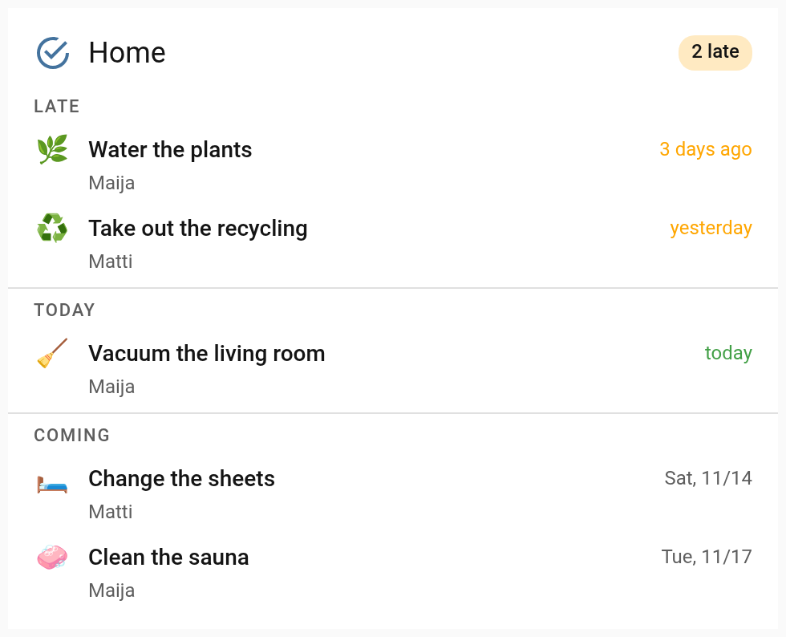
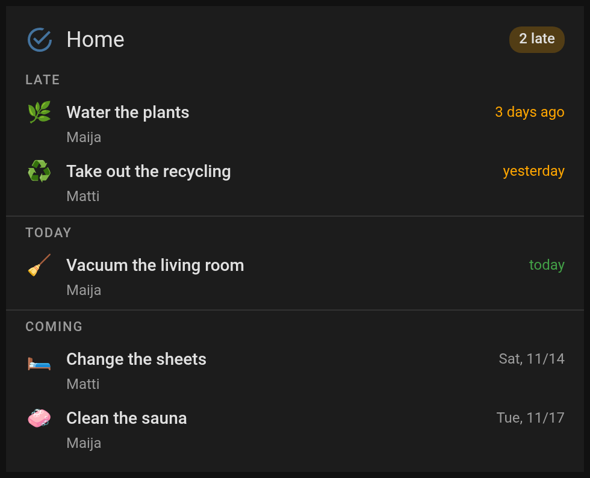
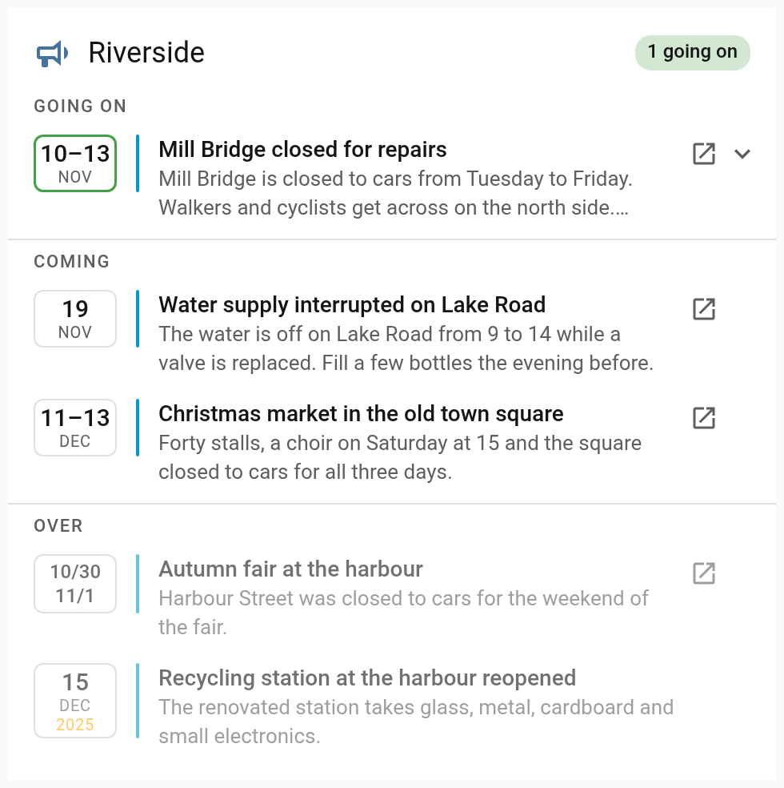
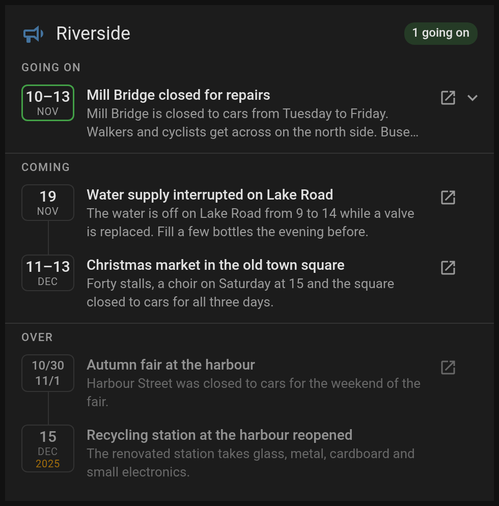
</p>

## What is it?

A custom card for the lists that sensors carry around in their attributes and that no card shows well, such as the
tasks of a chore app, the notices of a town, the events of a club or the parcels of a shop. You tell the card which entity holds the
list and which key of an item is its title, its date, its text and so on, and it draws the list. Nothing has to write
a format of the card's own, and no integration is needed. Home Assistant's own to-do lists are read as they are, and
their items can be ticked, added, edited and deleted on the card. Calendars are read as they are too, several merged
into one list if you like.

The items are grouped by their dates into what is over, what is going on today and what is to come, by one of their
keys, or not at all. One card can show several lists, each under its own name. The look is rows or a timeline with a
date badge, and an item's text is shown whole, cut to two lines or folded away until you tap the item.

The card shows what its entity holds and remembers nothing itself. The only lists it changes are to-do lists, and
`editing` limits that to ticks or turns it off.

## Installation

### With the Marketplace

1. Open Settings › Marketplace, choose Add from link and paste `https://github.com/jesmak/lists-card`
2. Open Lists card in the Marketplace and choose Install
3. Refresh your browser

### Manual

1. Take `dist/lists-card.js` from the source code of the [latest release][releases] and copy it to the `config/www`
   folder of your Home Assistant installation
2. In Home Assistant settings, open dashboards, click the three dots at the top right and open resources
3. Add a new resource with the path `/local/lists-card.js` and type JavaScript
4. Refresh your browser

## Options

| Name          | Type   | Description                                                                                                                                                                                                                                                         | Default  |
| ------------- | ------ | ------------------------------------------------------------------------------------------------------------------------------------------------------------------------------------------------------------------------------------------------------------------- | -------- |
| `type`        | string | `custom:lists-card`                                                                                                                                                                                                                                                 | required |
| `lists`       | list   | The lists, each as described under [A list](#a-list)                                                                                                                                                                                                                | required |
| `title`       | string | Shown at the top of the card, with a count beside it. Without a title and an icon the card has no header                                                                                                                                                            |          |
| `icon`        | string | An icon before the title                                                                                                                                                                                                                                            |          |
| `layout`      | string | `rows`, or `timeline` with each item's date as a badge                                                                                                                                                                                                              | `rows`   |
| `text`        | string | How an item's text is shown. `full` shows it whole, `clamp` cuts it to two lines, `fold` hides it. Cut or hidden, a tap on the item opens it                                                                                                                        | `clamp`  |
| `headings`    | string | The groups' headings. `plain`, or `fold` for headings that fold their group away                                                                                                                                                                                    | `plain`  |
| `height_mode` | string | How tall the card is. `auto` fits its content, `fixed` keeps it at `height`, `max` lets it grow up to `max_height`. In `fixed` and `max` the lists scroll. A height in grid rows, set in the layout tab of a sections view, is used instead of these                | `auto`   |
| `height`      | number | The card's height in pixels, for `fixed`                                                                                                                                                                                                                            |          |
| `max_height`  | number | The card's greatest height in pixels, for `max`                                                                                                                                                                                                                     |          |
| `row_step`    | string | How the card rounds its height on automatic rows in a sections view, with `height_mode` at `auto` or `max`. `full` ends it on whole rows, `half` on half rows, which saves up to half a row but can leave the cards under it half a row off those in other sections | `full`   |
| `editing`     | string | What the card may change on a to-do list. `full` for everything, `tick` for ticking and unticking only, `none` for nothing                                                                                                                                          | `full`   |

### A list

| Name         | Type    | Description                                                                                                                                                                                  | Default                      |
| ------------ | ------- | -------------------------------------------------------------------------------------------------------------------------------------------------------------------------------------------- | ---------------------------- |
| `entity`     | string  | The entity that holds the list                                                                                                                                                               | required                     |
| `entities`   | list    | More [calendars](#calendars) whose events are merged into a calendar's list, each as its entity, or as `entity` and `color` for a line of its own colour                                     |                              |
| `color`      | string  | The colour of the line beside the list's items. One of Home Assistant's own, such as `red` or `light-blue`, or any CSS colour                                                                | the theme's primary colour   |
| `attribute`  | string  | The attribute the items are in. Without one they are read from the entity's state, as JSON, or from a [to-do list](#to-do-lists) or a [calendar](#calendars) itself                          |                              |
| `path`       | string  | A path to the items inside the attribute, such as `data.items`, when they aren't at its top                                                                                                  |                              |
| `name`       | string  | The list's heading on a card with several lists                                                                                                                                              | the entity's name            |
| `fields`     | object  | Which key of an item holds each of the card's fields, as described under [Keys](#keys)                                                                                                       | each field's own name        |
| `group`      | string  | What the list's groups are made from. `time` for its items' dates, `key` for the values of the `group` field, `month` for the months of its items' dates, `none` for one list without groups | `time`                       |
| `limit`      | number  | The most items shown, from 1 to 100. The card says how many were left out, and a tap on that shows them and hides them again. Left out, the list shows all its items, up to 100              | none                         |
| `past_limit` | number  | The most items that are over shown, always the latest, counted within `limit`. The rest of `limit` goes to the others, and past items never take their places. `0` shows none                | no limit of its own          |
| `hide_more`  | boolean | With `limit`, the list is only its first items, with nothing said about the rest                                                                                                             | `false`                      |
| `order`      | list    | The time groups shown, in order, of `before`, `now`, `after` and `done`. The items of one left out aren't shown                                                                              | `[before, now, after, done]` |
| `before`     | object  | The group of items that are over, as described under [A time group](#a-time-group)                                                                                                           |                              |
| `now`        | object  | The group of items going on today, and of items with no date                                                                                                                                 |                              |
| `after`      | object  | The group of items still to come                                                                                                                                                             |                              |
| `done`       | object  | The group of a to-do list's ticked items                                                                                                                                                     |                              |
| `empty`      | string  | What the card says when the list has no items                                                                                                                                                | the card's own text          |

### Keys

Each of the card's fields is read from the key of the same name, unless `fields` names another. A key can be a path
into the item, such as `attributes.title`.

| Field   | What the card does with it                                                       |
| ------- | -------------------------------------------------------------------------------- |
| `title` | The item's title. An item without one is left out                                |
| `text`  | A longer text under the title. HTML is stripped from it                          |
| `start` | The item's date, or the first day of a period                                    |
| `end`   | The last day of a period                                                         |
| `label` | A short text set apart from the title, such as a person or a place               |
| `icon`  | An icon by its name, such as `mdi:broom`, or any short text, such as an emoji    |
| `link`  | An http or https address, opened by a button of its own on the item              |
| `group` | The value a list grouped by `key` is split on                                    |
| `id`    | What tells the item apart from the others. Without it the title and the dates do |

### A time group

| Name             | Type    | Description                                                                                                                        | Default                      |
| ---------------- | ------- | ---------------------------------------------------------------------------------------------------------------------------------- | ---------------------------- |
| `name`           | string  | The group's heading                                                                                                                | Earlier, Now, Coming, Ticked |
| `tone`           | string  | How the group's items are set off. `plain`, `warning`, `highlight` or `dimmed`                                                     | `plain`, for `done` `dimmed` |
| `days`           | number  | How many days back or ahead the group reaches. Items further away are left out                                                     |                              |
| `farthest_first` | boolean | The items furthest from today first. Usually the nearest come first, the latest of what is over and the soonest of what is to come | `false`                      |

Every option is in the visual editor, except `height_mode`, `height` and `max_height`, which are set in YAML. In a
sections view the layout tab sets the card's height. They are for where there is no layout tab, such as a masonry or
panel view, or a stack or other card the card is inside, even in a sections view.

## What it shows

Under the title come the groups, each with its heading and its items. An item has its icon, its title, its label and
its date, and under them its text. With a link, it has a button that opens the link in a new tab.

### Groups

A list grouped by time has up to three groups, and a to-do list a fourth one, `done`. An item is over when its last day
is before today, to come when its first day is after today, and going on otherwise, which is where an item with no
date goes too. A ticked to-do item is done, whatever its dates. Each group's name, tone, reach and order are yours to
set, so the same groups are "Late, Today, Coming" for tasks and "Going on, Coming, Over" for events.

A tone sets a group's items off. `warning` and `highlight` colour the date, `dimmed` fades the whole item, and a past
day in a `warning` group is written as how long ago it was, such as "3 days ago". On a card with one list whose
first group has a `warning` or `highlight` tone, the count beside the title is that group's, with its name, such as "2 late". Otherwise it is the
number of items on the card that aren't done.

A list grouped by `key` has a group for each value of the `group` field, in the order the values first come up. Items
without one are together in a group with no heading.

A list grouped by `month` has a group for each month its items begin in, named by the month, such as "November", with
its year when that isn't this one. The items are in the order of their days, past months first, as a calendar reads.
The time groups still decide which items are shown and how each is set off, so today's can still be highlighted.

With several lists on a card, the headings are the lists, and a list's own groups only decide the order of its items.

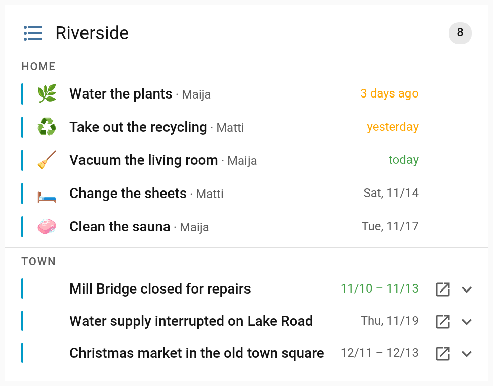
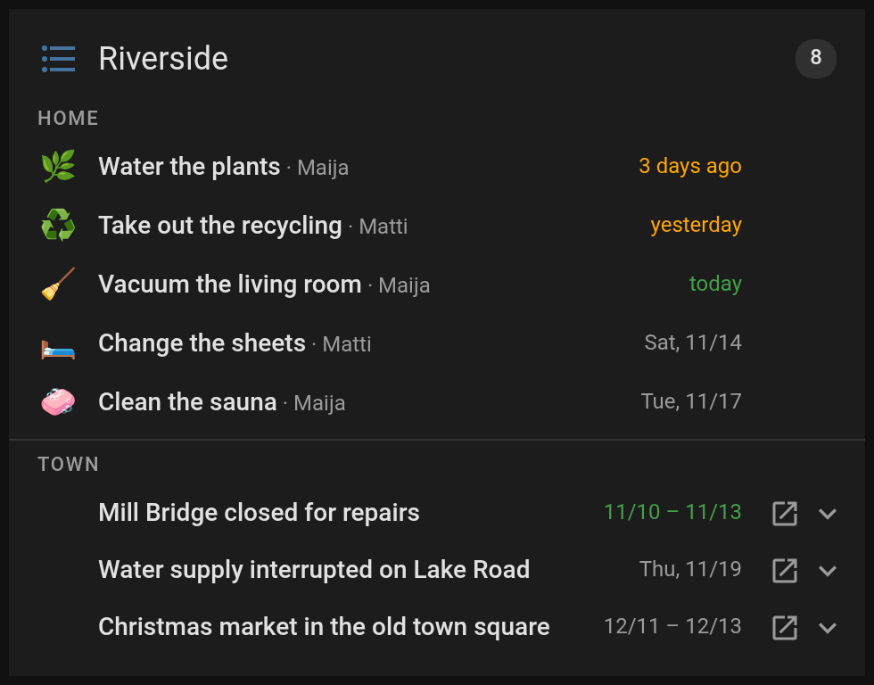

### To-do lists

An entity of Home Assistant's own to-do lists, such as `todo.shopping_list`, given with no `attribute`, is read as a
to-do list. Its items need no keys. An item's summary is its title, its description its text, and the day it is due
its date. A done item is dated by when it was ticked, where the list keeps that, so `days` in the `done` group says
for how many days a ticked item stays in sight.

Each item has a round tick before its title. A tap on it ticks the item done or open again, and the item is struck
through at once. It stays where it is for a moment before it moves, so a tick by mistake can be undone where it was
made. To leave the done items out, leave `done` out of `order`.

A tap on an item opens it for editing, with its title, its description, its day and its time. The + in the header
opens the same fields for a new item. Enter in the title saves and Escape closes without saving. An open item without
a day can be moved one row up or down among the others without one, as the card keeps the dated items in the order of
their days. "Delete ticked" beside the done group's heading deletes every ticked item of the list, once you have said
yes.

The card offers only what the list's integration supports. Home Assistant's own local to-do lists support all of it,
while some others take no description, no day or no time of day, or let no item be moved, changed or deleted. With `editing:
tick` a tap opens an item's text as on any other list, and only the tick changes anything. On a list that can't be
changed, and with `editing: none`, the tick only shows whether an item is done.

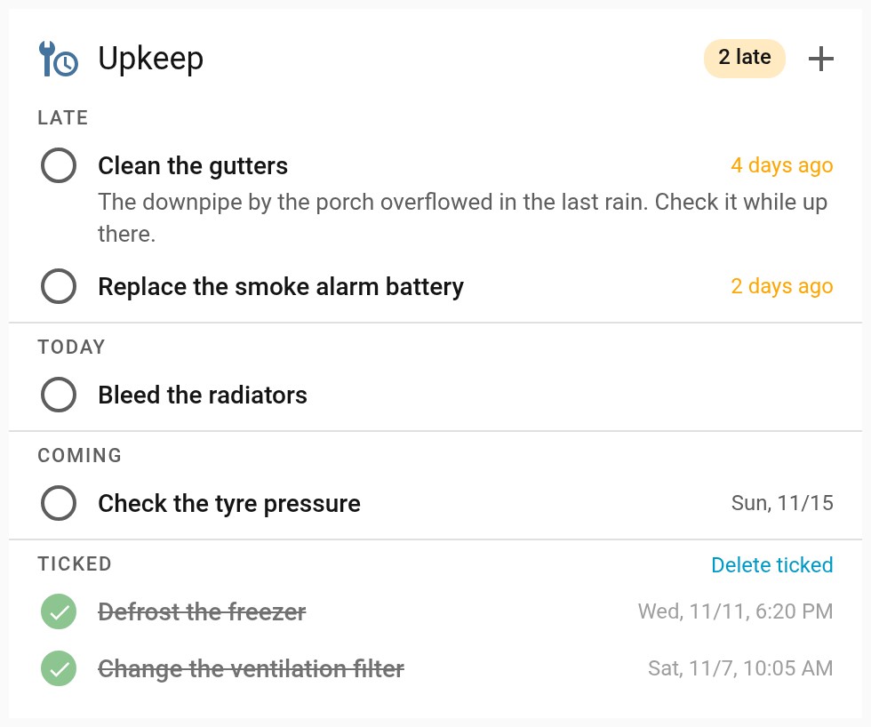
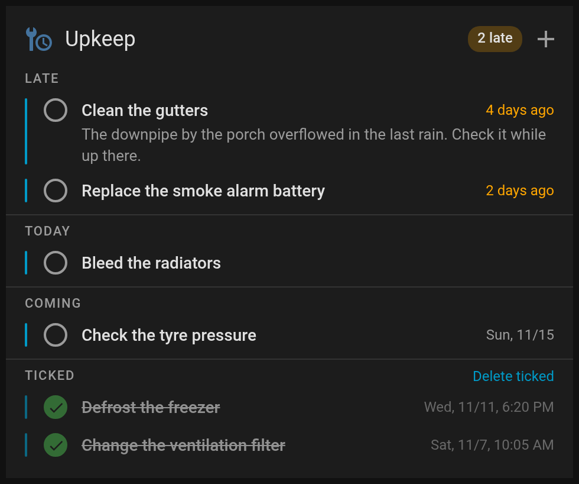

### Calendars

A calendar entity, such as `calendar.family`, given with no `attribute`, is read as a calendar. An event's summary is
its title, its description its text, its place its label, and its start and end its dates. A whole-day event ends on
its last day, though a calendar gives the day after it. Each time of a repeating event is an item of its own. The
calendars in `entities` are merged into the same list, such as the public holidays among the family's events. Each
can have a colour of its own for the line beside its events, so you can tell where an event comes from.

The card asks for the events as far back as the list's `before` group reaches and as far ahead as its `after` group
does, the days back and ahead on the list's page in the visual editor. A calendar added in the visual editor starts with
0 days back and 30 ahead. With no days set, there is no limit in days, and as a calendar can't give all its events at
once, a year back or ahead is asked for. The days and the `limit` are limits of their own. With 5 days ahead and a
limit of 50, the list shows the events of those 5 days, 50 at most. A group left out of `order` isn't asked for. The card shows the
events and changes nothing in a calendar.

### Dates

A date is a day or a time, and a period has a first and a last one. In rows the date is written beside the title, a
period as a range, today as "today", and any other day with its weekday. The year is written only when it isn't this
year's. In the timeline the date is a badge, the day large and the month under it, and a period within one month shows
both its days. A period across two months shows its first and last day, one over the other. A year that isn't this
one stands out in the badge. What the badge can't say, such as a time of day, is written under the title.

The dates are written by the browser in Home Assistant's language, and the day is the one in the time zone your Home
Assistant profile is set to show.

### Texts and folding

With `text: fold` an item is a single line until you tap it, and with `headings: fold` each group folds away under
its heading, which then shows how many items it has. With `text: clamp` only an item whose text was actually cut opens
on a tap.

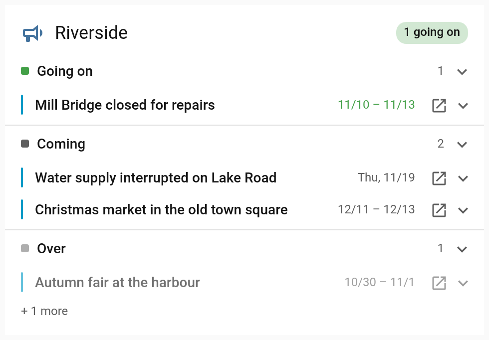
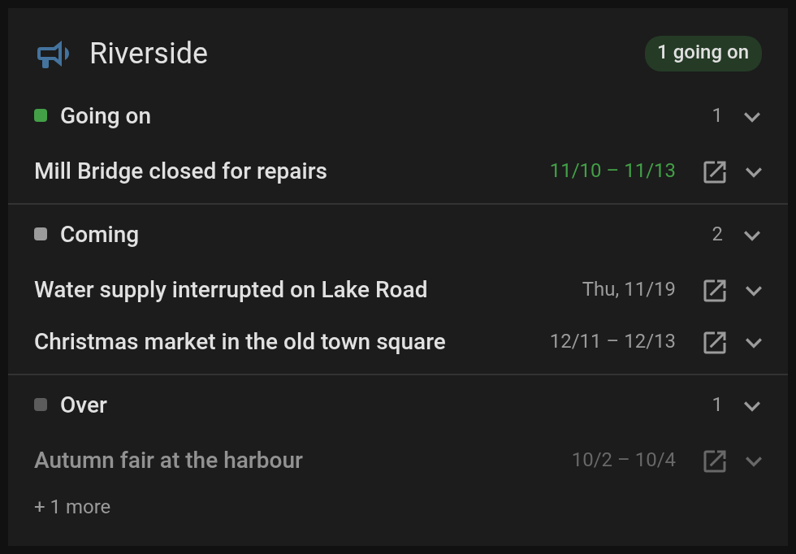

### Sizes

In a sections view the card takes 12 columns by default and at least 6, and grows as tall as its lists. On automatic
rows it ends on whole rows, and any room left over goes under the title. With `row_step: half` it ends on half rows
instead. On a narrow card, an item's date and buttons go under its title when the title has too little room beside
them.

Held to a height, by rows set in the layout tab or by `height` or `max_height`, the header stays where it is and the
lists scroll under it. Titles, labels and headings then keep to one line each, cut short with their whole text as a
tooltip. The card never gets lower than its header, one heading and one item with two lines of text need, which is 174
pixels with a header and 130 without.

## Examples

Each example shows what the entity holds, as Developer tools › States shows its attributes, the card's configuration,
and the card it makes. The pictures are taken on 12 November 2026, which decides what is over and what is to come.

### Household tasks

A chore app's sensor with a `tasks` attribute, each task with a `title`, an `icon`, a `due` day and `who` is to do it.
The most overdue task comes first, and tasks more than a week away are left out.

The entity's attributes:

```yaml
friendly_name: Chores
tasks:
  - title: Water the plants
    icon: 🌿
    due: "2026-11-09"
    who: Maija
  - title: Take out the recycling
    icon: ♻️
    due: "2026-11-11"
    who: Matti
  - title: Vacuum the living room
    icon: 🧹
    due: "2026-11-12"
    who: Maija
  - title: Change the sheets
    icon: 🛏️
    due: "2026-11-14"
    who: Matti
  - title: Clean the sauna
    icon: 🧼
    due: "2026-11-17"
    who: Maija
  - title: Wash the windows
    icon: 🪟
    due: "2026-11-30"
    who: Matti
```

The card:

```yaml
type: custom:lists-card
title: Home
icon: mdi:checkbox-marked-circle-outline
lists:
  - entity: sensor.chores
    attribute: tasks
    fields:
      start: due
      label: who
    before:
      name: Late
      tone: warning
      farthest_first: true
    now:
      name: Today
      tone: highlight
    after:
      name: Coming
      days: 7
    empty: Nothing to do right now.
```


### Notices as a timeline

What is going on first, then what is to come, then the latest of what is over, five in all. The texts are HTML, which
the card strips.

The entity's attributes, with two of its five notices:

```yaml
friendly_name: Town notices
notices:
  - id: n1
    title: Mill Bridge closed for repairs
    from: "2026-11-10"
    to: "2026-11-13"
    text: <p>Mill Bridge is closed to cars from Tuesday to Friday.</p><p>Walkers and cyclists get across on the north
      side. Buses 4 and 7 go round by Station Road and skip the stops at the bridge.</p>
    url: https://example.com/notices/n1
  - id: n2
    title: Water supply interrupted on Lake Road
    from: "2026-11-19"
    text: <p>The water is off on Lake Road from 9 to 14 while a valve is replaced. Fill a few bottles the evening
      before.</p>
    url: https://example.com/notices/n2
```

The card:

```yaml
type: custom:lists-card
title: Riverside
icon: mdi:bullhorn-outline
layout: timeline
lists:
  - entity: sensor.town_notices
    attribute: notices
    fields:
      start: from
      end: to
      link: url
    order: [now, after, before]
    now:
      name: Going on
      tone: highlight
    before:
      name: Over
      tone: dimmed
    limit: 5
```


### A to-do list

What is late first, the most overdue at the top, and what was ticked in the past week dimmed at the bottom.

A to-do list keeps its items out of its attributes. The card asks Home Assistant for them, and gets them like this:

```yaml
- uid: u1
  summary: Clean the gutters
  status: needs_action
  due: "2026-11-08"
  description: The downpipe by the porch overflowed in the last rain. Check it while up there.
- uid: u2
  summary: Replace the smoke alarm battery
  status: needs_action
  due: "2026-11-10"
- uid: u3
  summary: Bleed the radiators
  status: needs_action
- uid: u4
  summary: Check the tyre pressure
  status: needs_action
  due: "2026-11-15"
- uid: u5
  summary: Defrost the freezer
  status: completed
  completed: "2026-11-11T16:20:00+00:00"
- uid: u6
  summary: Change the ventilation filter
  status: completed
  completed: "2026-11-07T08:05:00+00:00"
```

The card:

```yaml
type: custom:lists-card
title: Upkeep
icon: mdi:wrench-clock
lists:
  - entity: todo.upkeep
    before:
      name: Late
      tone: warning
      farthest_first: true
    now:
      name: Today
      tone: highlight
    done:
      days: 7
```

The picture is under [To-do lists](#to-do-lists).

### Calendars merged into one

A family's calendar with the public holidays among its events, as a timeline. A calendar too keeps its events out of
its attributes, and the card gets them from Home Assistant like this, from the family's calendar:

```yaml
- summary: Choir rehearsal
  start: "2026-11-12T18:00:00+02:00"
  end: "2026-11-12T19:30:00+02:00"
  location: Riverside church
  uid: c1
  recurrence_id: "20261112T180000"
- summary: Dentist
  start: "2026-11-16T08:15:00+02:00"
  end: "2026-11-16T09:00:00+02:00"
  uid: d1
- summary: Choir rehearsal
  start: "2026-11-19T18:00:00+02:00"
  end: "2026-11-19T19:30:00+02:00"
  location: Riverside church
  uid: c1
  recurrence_id: "20261119T180000"
- summary: Cabin weekend
  start: "2026-11-27"
  end: "2026-11-30"
  description: Take the sauna towels and the long johns.
  uid: w1
  all_day: true
```

And from the holidays' calendar:

```yaml
- summary: Independence Day
  start: "2026-12-06"
  end: "2026-12-07"
  uid: h1
  all_day: true
```

The card:

```yaml
type: custom:lists-card
title: Calendar
icon: mdi:calendar
layout: timeline
lists:
  - entity: calendar.family
    entities:
      - entity: calendar.holidays
        color: red
    now:
      name: Today
      tone: highlight
    after:
      name: Coming
```

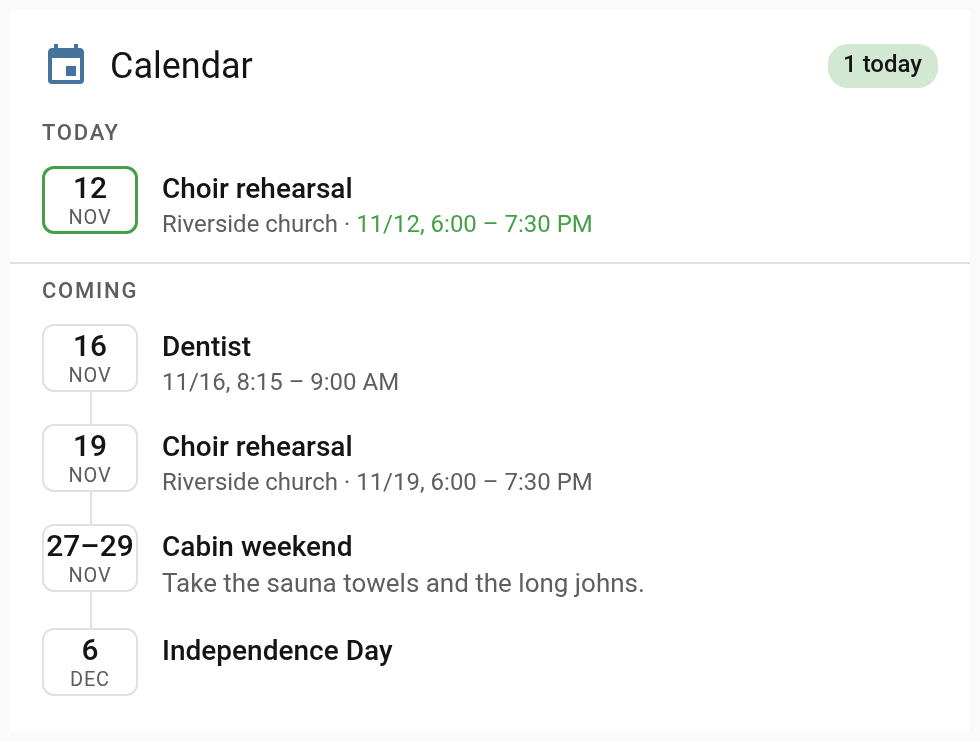
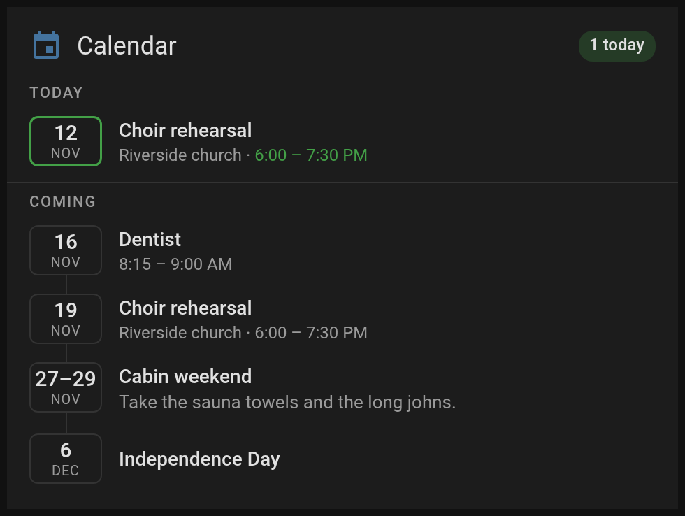

A calendar stores an all-day event's end as the day after its last one, so the cabin weekend comes as the 27th to the
30th. The card shows the days it lasts, the 27th to the 29th. The holiday's line is red, the family's in the theme's
primary colour.

### A list nested in an answer

A REST sensor that keeps an API's whole answer in an attribute, with the items under `features` and each item's
values under `attributes`. The grouping is the card's own, so the groups' names are its own too.

The entity's attributes:

```yaml
friendly_name: Road works
answer:
  type: FeatureCollection
  features:
    - attributes:
        name: Resurfacing on Station Road
        description: One lane open, with traffic lights at both ends.
        starts: "2026-11-02"
        ends: "2026-11-20"
    - attributes:
        name: New water main on Birch Street
        description: Closed between Mill Street and the school. The detour is signposted.
        starts: "2026-11-16"
        ends: "2026-12-04"
    - attributes:
        name: Bridge railing repairs
        description: The pavement on the east side was closed.
        starts: "2026-10-12"
        ends: "2026-11-06"
```

The card:

```yaml
type: custom:lists-card
title: Road works
lists:
  - entity: sensor.road_works
    attribute: answer
    path: features
    fields:
      title: attributes.name
      text: attributes.description
      start: attributes.starts
      end: attributes.ends
```

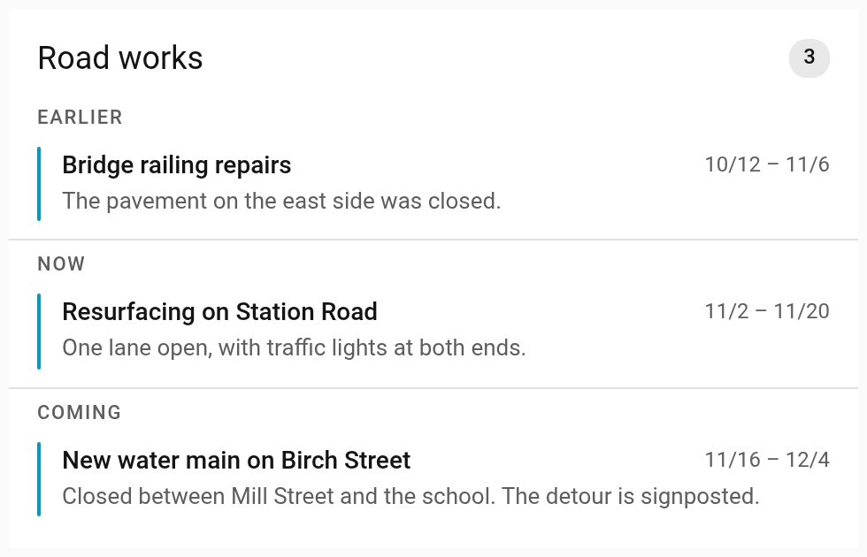
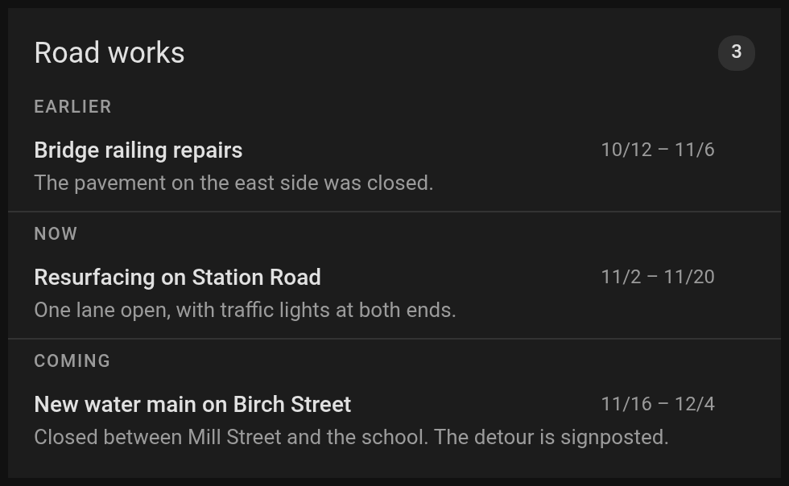

### Grouped by a key, without dates

A list grouped by the shop each item is bought from, the shops in the order they first come up. An item with no shop
goes to a group with no heading.

The entity's attributes:

```yaml
friendly_name: Shopping list
items:
  - name: Milk
    shop: Grocery
  - name: Rye bread
    shop: Grocery
  - name: Light bulbs, E27
    shop: Hardware store
  - name: Oat flakes
    shop: Grocery
  - name: Wood screws, 4 × 40
    shop: Hardware store
  - name: Stamps
```

The card:

```yaml
type: custom:lists-card
title: Shopping
text: full
lists:
  - entity: sensor.shopping_list
    attribute: items
    group: key
    fields:
      title: name
      group: shop
```

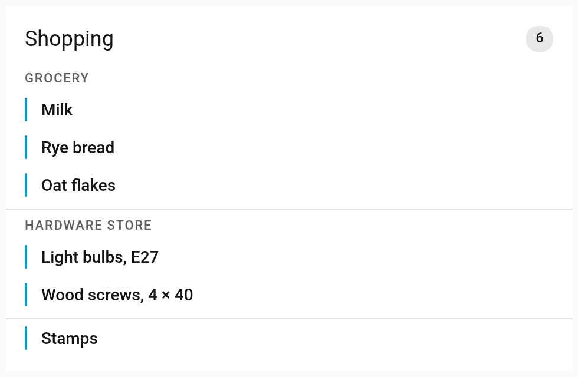
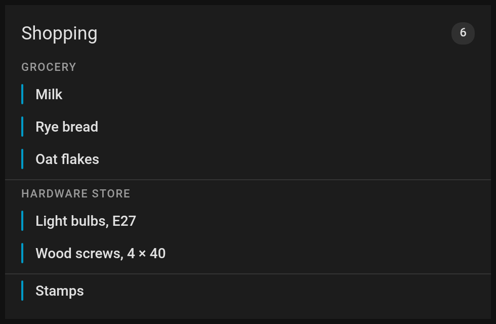

Without `group`, the items would be one list grouped by time, all in its now group, as none has a date.

## Data

The card reads its items from an entity in Home Assistant and fetches nothing itself. The items can be:

- a list of objects in an attribute
- a list deeper inside an attribute, reached with `path`
- an object whose keys are ids and whose values are the items
- any of those as JSON text, in an attribute or, with no `attribute` set, in the entity's state
- a list of plain texts, each then an item's title
- a to-do list's items, which the card subscribes to, as the entity itself holds only how many are open
- a calendar's events, which the card subscribes to over the days its list's groups reach

A date is one of these. Anything else is not taken for a date, and the item then has none.

| Form                               | Example                     | Read as        |
| ---------------------------------- | --------------------------- | -------------- |
| A day, ISO 8601                    | `2026-03-01`                | That whole day |
| A day, day first with full stops   | `1.3.2026`                  | That whole day |
| A time with its date               | `2026-03-01T10:30:00+02:00` | That moment    |
| Seconds or milliseconds since 1970 | `1772361000`                | That moment    |

A text with no four-digit year is left out, as a browser would make up a year of its own for it. A link that isn't an
http or https address is left out too, as the items come from outside Home Assistant.

A REST sensor turns an XML answer into the same objects by itself, so the card reads such a list like any other. A
list that needs shaping first, such as one filtered or put together from several entities, is best made by a template
sensor with the list in an attribute.

## Translating

The card's texts are in `src/localize/languages/`, one JSON file per language, named by its language code, such as
`en.json` and `fi.json`. To add a language, copy `en.json` to the new language's code, such as `sv.json`, and
translate the values. Nothing else needs changing. The card finds the file by itself and uses it when Home Assistant
is set to that language. A text left out falls back to English. The items' own texts are shown as they are.

## Development

Requires Node 22.13 or newer.

```
npm install
npm run check
```

`npm run check` typechecks, lints, checks formatting, runs the tests and builds `dist/lists-card.js`, which is the file
the Marketplace installs and is committed to the repository.

| Path                       | What it contains                                                              |
| -------------------------- | ----------------------------------------------------------------------------- |
| `src/lists-card.ts`        | The card itself                                                               |
| `src/editor.ts`            | The visual editor                                                             |
| `src/lists.ts`             | Reading a list's items from an entity, and arranging them into groups         |
| `src/types.ts`             | The card's options and the shapes of what it shows                            |
| `src/const.ts`             | The card's version                                                            |
| `src/hass.ts`              | The few Home Assistant types the card needs                                   |
| `src/height.ts`            | The height mode, shared with the author's other cards                         |
| `src/rows.ts`              | Rounding to the rows of a sections view, shared with the author's other cards |
| `src/fade.ts`              | The fading edges of what scrolls, shared with the author's other cards        |
| `src/localize/localize.ts` | Finding the viewer's language and its texts                                   |
| `scripts/build.mjs`        | The esbuild build                                                             |
| `src/localize/languages/`  | The card's texts, one JSON file per language                                  |
| `docs/screenshots.json`    | The made-up data the README's screenshots are taken from                      |
| `tests/`                   | Tests, run with vitest                                                        |

## Support

Hey dude! Help me out for a couple of :beers: or a :coffee:!

[](https://www.buymeacoffee.com/jesmak)

## License

MIT, see [LICENSE](LICENSE).

[releases-shield]: https://img.shields.io/github/release/jesmak/lists-card.svg?style=for-the-badge
[release-date-shield]: https://img.shields.io/github/release-date/jesmak/lists-card?style=for-the-badge
[releases]: https://github.com/jesmak/lists-card/releases
[downloads-shield]: https://img.shields.io/github/downloads/jesmak/lists-card/total.svg?style=for-the-badge
[marketplace-shield]: https://img.shields.io/badge/Marketplace-Custom-orange.svg?style=for-the-badge
[marketplace]: https://my.home-assistant.io/redirect/marketplace_repository/?owner=jesmak&repository=lists-card&category=plugin
[license-shield]: https://img.shields.io/github/license/jesmak/lists-card.svg?style=for-the-badge
